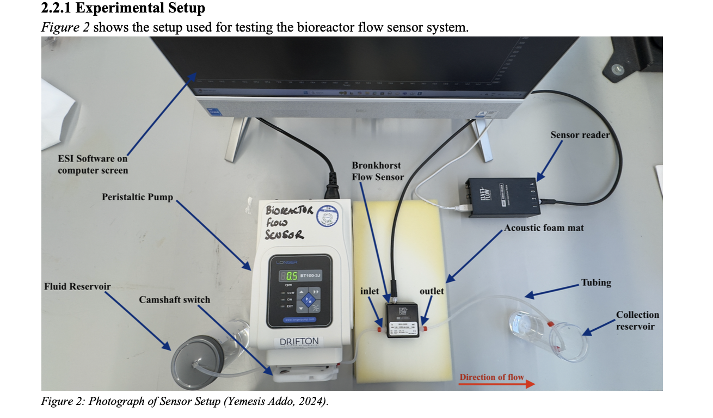
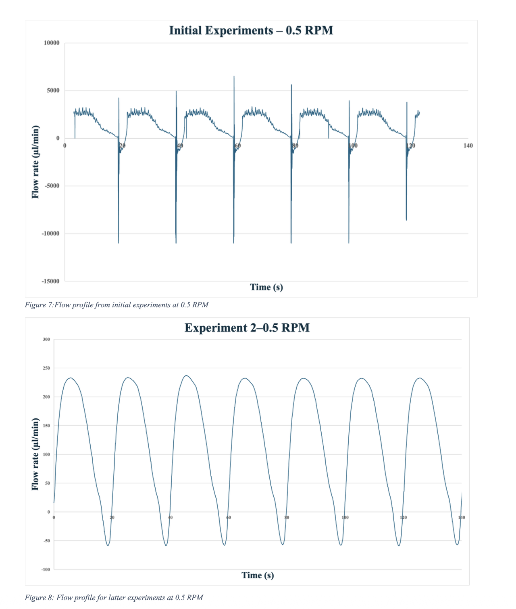
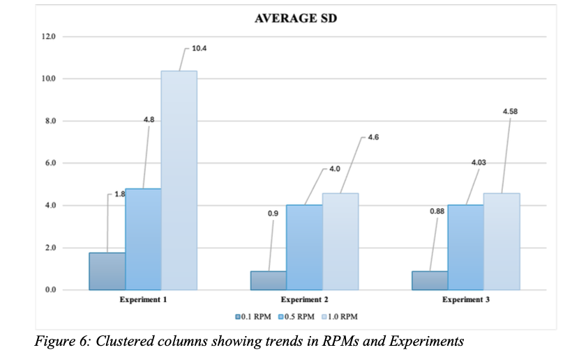

# Precision Nutrient Delivery for Tissue Engineering Bioreactors

Bone tissue grown in a lab depends on fluid flowing through it at the right rate. Too little and the cells starve, too much and the shear stress damages them. This was my final-year project: making an in-line flow sensor reliable enough to monitor that flow in real time.

**Final-year Integrated Design Project · team of five (BioT) · individual report · Queen Mary University of London, 2024–25**

## What I did

Our team was designing a perfusion bioreactor for bone tissue engineering. My part was the flow-sensing system. I integrated an Elveflow Bronkhorst in-line flow sensor into the bioreactor circuit, then designed and ran more than 80 experiments to calibrate it and find the set-up that gave the most accurate, repeatable readings. I tested two tubing diameters, four pump occlusion levels and different ways of damping vibration, and logged and analysed every run in Excel.

## What went wrong

Early on, the sensor's readings didn't match my manual measurements. I restarted experiments, got frustrated with the quality of my data, and eventually asked my supervisor for guidance. Her advice was to study the "wrong" data rather than throw it away. The pattern in it pointed to a scaling-factor error in the sensor settings, along with cyclic distortions in the signal. Correcting the scale factor and lowering the acquisition frequency from 100 Hz to 10 Hz gave much cleaner, more reliable flow profiles.

It changed how I treat data. Some data can be corrupt, but all data is useful.

The project also had real limits. I tested with deionised water rather than culture media, and the sensor software was unstable enough to need frequent recalibration. Both are in the report's recommendations for future work.

## Results

- The best set-up was 2.4 mm internal-diameter tubing, pump occlusion level 7 and vibration-damping cushions.
- Real-time flow measurement accuracy improved by about 20%.
- Wider tubing gave clearly lower variation between runs, and occlusion turned out to be a trade-off: level 7 beat both looser and tighter settings.

## Tools

In-line flow sensor · perfusion bioreactor · peristaltic pump · Microsoft Excel

## Files

- [Project report](./precision-nutrient-delivery-bioreactor-report.pdf)
- [Team presentation](./precision-nutrient-delivery-project-presentation.pdf)

Supervised by Professor Karin Hing. Team members' names are removed from the shared files for privacy.
